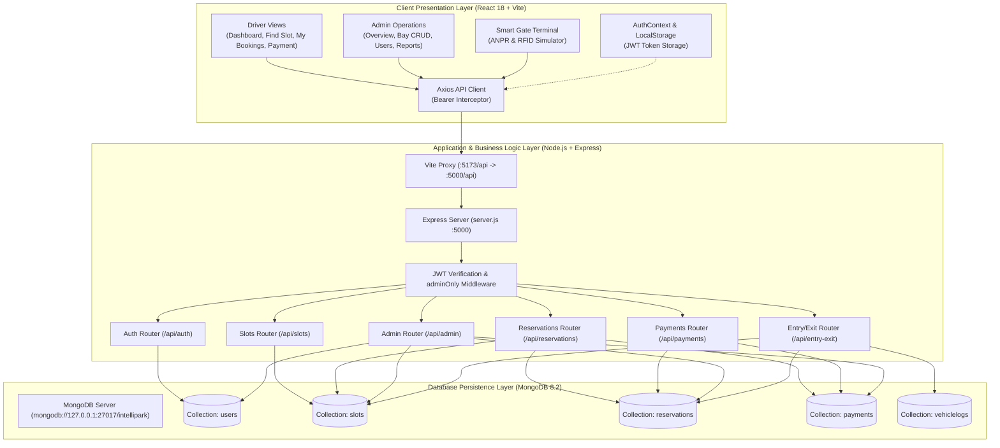
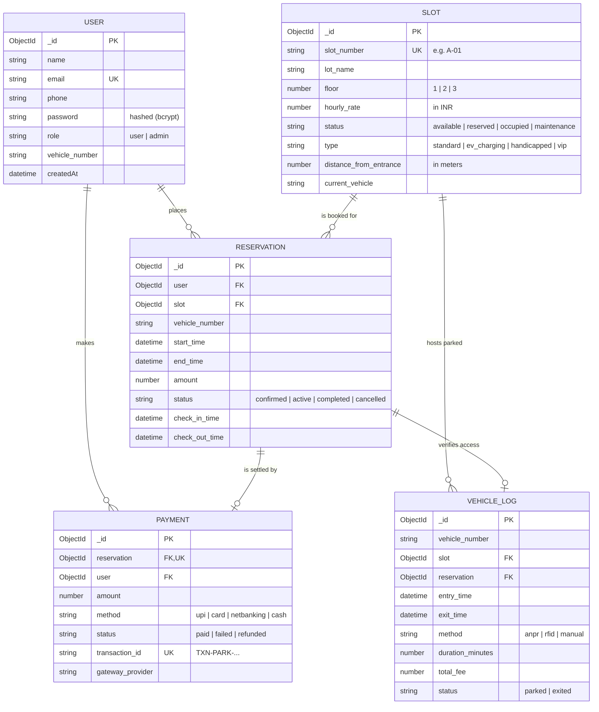
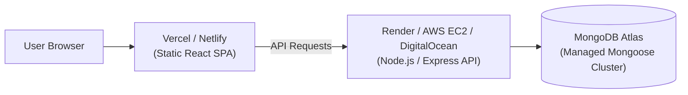

# IntelliPark — Smart Parking Management System

[](https://nodejs.org/)
[](https://react.dev/)
[](https://vitejs.dev/)
[](https://expressjs.com/)
[](https://www.mongodb.com/)
[](LICENSE)

> A full-stack, database-driven smart parking management system for multi-level facilities, shopping malls, and corporate campuses. Features real-time bay sensor status, 2D interactive schematic floor plans, entrance-proximity guidance, conflict-free booking, digital payment receipts, administrative business intelligence, and an automated barrier gate terminal with simulated Automatic Number Plate Recognition (ANPR) and FASTag/RFID telemetry.

---

## Table of Contents

1. [Project Overview](#1-project-overview)
2. [Key Features](#2-key-features)
3. [Technology Stack](#3-technology-stack)
4. [System Architecture](#4-system-architecture)
5. [Directory & File Structure](#5-directory--file-structure)
6. [Frontend Deep Dive](#6-frontend-deep-dive)
7. [Backend Deep Dive](#7-backend-deep-dive)
8. [Database Design & DBMS Concepts](#8-database-design--dbms-concepts)
9. [End-to-End Workflow Walkthrough](#9-end-to-end-workflow-walkthrough)
10. [Installation & Windows Setup Guide](#10-installation--windows-setup-guide)
11. [Environment Variables](#11-environment-variables)
12. [Complete REST API Reference](#12-complete-rest-api-reference)
13. [Authentication & Security](#13-authentication--security)
14. [Automated Testing & Quality Verification](#14-automated-testing--quality-verification)
15. [Troubleshooting Guide](#15-troubleshooting-guide)
16. [Production Deployment Considerations](#16-production-deployment-considerations)
17. [Hardware Integration Boundaries & Roadmap](#17-hardware-integration-boundaries--roadmap)
18. [Computer Science & DBMS Learning Guide](#18-computer-science--dbms-learning-guide)
19. [Frequently Asked Questions (FAQ)](#19-frequently-asked-questions-faq)
20. [License & Acknowledgments](#20-license--acknowledgments)

---

## 1. Project Overview

### Problem Statement
Finding parking in high-density urban environments (malls, airports, hospitals, tech parks) is inefficient and stressful. Drivers circle crowded lots looking for spots, burning fuel and causing congestion. Meanwhile, facility managers lack real-time visibility into occupancy, struggle to prevent double-booking, and rely on error-prone paper tickets or isolated cash collection systems.

### The Solution: IntelliPark
**IntelliPark** bridges the gap between hardware telemetry and driver convenience:
- Drivers can check live parking availability across multiple floors, receive algorithmic recommendations for the closest bay to the entrance, reserve spots in advance without double-booking conflicts, and receive instant digital gate passes.
- Facility operators gain an Operations Command Center showing live occupancy meters, automated capacity alerts, floor-by-floor utilization metrics, revenue reports with CSV exports, and a gate terminal simulating ANPR and RFID access control.
- Designed as a robust showcase of **Database Management System (DBMS)** principles, including atomicity, referential integrity, indexing, complex aggregation pipelines, and constraint verification.

---

## 2. Key Features

### Feature Breakdown Table

| Feature | Category | Implementation Status | Core Technical Component |
| :--- | :--- | :--- | :--- |
| **Driver Command Dashboard** | User Experience | Fully Implemented | `UserDashboard.jsx` + `/api/reservations/active-now` |
| **Interactive 2D Parking Map** | User Experience | Fully Implemented | `ParkingSchematicMap.jsx` + `Slot.js` |
| **Nearest Available Bay Guidance** | Smart Routing | Fully Implemented | `/api/slots/nearest` (Distance-based sorting) |
| **Atomic Clash-Free Reservations**| Concurrency/DBMS | Fully Implemented | `reservations.js` ($lt/$gt interval overlap query) |
| **Digital Pass & QR Receipt** | Booking / Billing | Fully Implemented | `Modal.jsx` + `MyReservations.jsx` (Print support) |
| **Transparent Tariff & Checkout**| Billing | Fully Implemented (Demo Gateway) | `Payment.jsx` + `/api/payments` (Unique `TXN-` ID) |
| **Operations Command Center** | Administration | Fully Implemented | `AdminDashboard.jsx` + Multi-segment Occupancy Bar |
| **Bays Management (CRUD)** | Administration | Fully Implemented | `ManageSlots.jsx` + Safe deletion constraint |
| **Driver User Directory** | Administration | Fully Implemented | `ManageUsers.jsx` + Aggregated booking statistics |
| **Analytics & BI Reporting** | Analytics/BI | Fully Implemented | `Reports.jsx` + Pure SVG dynamic bar chart + CSV export |
| **Smart Barrier Gate Simulator** | IoT / Telemetry | Fully Implemented (Demo Engine) | `GateTerminal.jsx` + `VehicleLog.js` + `/api/entry-exit` |
| **Physical Camera / Hardware Relay**| Hardware | Architectural Boundary Prepared | Webhook ready; simulated in `/terminal` |

---

### Detailed Feature Descriptions

#### 1. Real-Time Parking Availability & 2D Schematic Floor Plan
- **What it does:** Renders a schematic floor plan of the facility showing driving lanes, entrance points, speed limits, and color-coded parking bays (Green = Available, Red = Occupied, Amber = Reserved, Gray = Maintenance).
- **How it works:** Polls the database every 15 seconds. Clicking an available bay opens a reservation drawer pre-filled with that bay's specifications.
- **Components:** `Dashboard.jsx`, `ParkingSchematicMap.jsx`, `SlotCard.jsx`, `Slot.js`.

#### 2. Nearest-Bay Recommendation Engine
- **What it does:** Recommends the single best bay for a driver based on walking distance to the main entrance/elevators.
- **How it works:** Queries MongoDB using `find({ status: 'available' }).sort({ distance_from_entrance: 1, floor: 1 })`. Explains the exact distance (e.g., *~8m from entrance*) to the user.
- **Components:** `UserDashboard.jsx`, `Dashboard.jsx`, `/api/slots/nearest`.

#### 3. Concurrency-Safe, Clash-Free Reservations
- **What it does:** Prevents two drivers from reserving the same bay for overlapping time intervals.
- **How it works:** Validates that the start time is in the future and that end time > start time (minimum 30 minutes). Performs an atomic conflict query:
  $$\text{RequestedStart} < \text{ExistingEnd} \quad \text{AND} \quad \text{RequestedEnd} > \text{ExistingStart}$$
  If a conflict exists, returns `409 Conflict`. If valid, creates the reservation and updates imminent slots to `reserved`.
- **Components:** `reservations.js`, `Reservation.js`.

#### 4. Digital Parking Pass & Receipts
- **What it does:** Provides drivers with a verifiable parking pass containing an automated QR code, booking reference, assigned level, vehicle plate number, duration, and status.
- **How it works:** Available under "My Bookings" with a dedicated "Print Pass" stylesheet.
- **Components:** `MyReservations.jsx`, `Modal.jsx`.

#### 5. Simulated Digital Payment Checkout
- **What it does:** Displays an itemized tariff breakdown (hourly rate $\times$ hours + taxes) and supports UPI, Credit/Debit Cards, Net Banking, and Pay-at-Gate.
- **How it works:** Validates against duplicate payments on the same reservation using unique Mongoose indexes. Generates verifiable transaction references (`TXN-PARK-...`).
- **Components:** `Payment.jsx`, `payments.js`, `Payment.js`.

#### 6. Operations Command Center & Alerts
- **What it does:** Gives administrators a comprehensive overview of capacity, occupancy percentage, today's revenue, active bookings, and alerts (e.g., 100% full or low availability warnings).
- **How it works:** Aggregates live slot counts and revenue via MongoDB `$match` and `$group` operators.
- **Components:** `AdminDashboard.jsx`, `admin.js`.

#### 7. Business Intelligence, SVG Charting & CSV Export
- **What it does:** Visualizes revenue trends over 7, 14, or 30 days, displays floor utilization rates, highlights the top 5 most booked bays, and exports raw data to `.csv`.
- **How it works:** Built using lightweight, zero-dependency pure SVG elements with dynamic scale calculations. Generates browser-native Blob URLs for CSV download.
- **Components:** `Reports.jsx`, `/api/admin/reports`.

#### 8. Smart Barrier Gate Terminal (ANPR / RFID Simulator)
- **What it does:** Simulates boom barrier operations at entrance and exit gates.
- **How it works:** 
  - **Arrival:** Scans a vehicle plate using simulated Optical Character Recognition (ANPR) or RFID/FASTag. Automatically links to existing reservations, sets bay status to `occupied`, and signals `BARRIER OPEN`.
  - **Departure:** Calculates duration, computes fees, marks reservation `completed`, releases the bay to `available`, and signals `BARRIER OPEN`.
- **Components:** `GateTerminal.jsx`, `entryExit.js`, `VehicleLog.js`.

---

## 3. Technology Stack

| Technology | Role | Purpose / Benefit | Location in Codebase |
| :--- | :--- | :--- | :--- |
| **Node.js** (v18+) | Runtime Engine | Asynchronous, event-driven server runtime | `backend/server.js` |
| **Express.js** (v4.19) | Web API Framework | Modular routing, middleware pipelines, JSON handling | `backend/routes/*.js` |
| **MongoDB** (v6+/v8.2) | NoSQL Database | Flexible document store, high-speed aggregation pipelines | Local service (`mongod`) |
| **Mongoose** (v8.5) | Object Data Modeling (ODM) | Schema validation, type casting, lifecycle hooks, indexing | `backend/models/*.js` |
| **React** (v18.3) | UI Component Library | Declarative virtual DOM rendering for responsive state updates | `frontend/src/**/*.jsx` |
| **Vite** (v5.4) | Frontend Build Tool | Near-instant HMR, ES module bundling, fast production build | `frontend/vite.config.js` |
| **React Router** (v6.26) | Client-Side Routing | SPA navigation, protected routes, URL state synchronization | `frontend/src/routes/` |
| **Axios** (v1.7) | HTTP Client | Promise-based API requests with automatic JWT interceptors | `frontend/src/services/api.js` |
| **JSON Web Token (JWT)** | Authorization | Stateless authentication and role-based access tokens | `backend/middleware/auth.js` |
| **Bcrypt.js** (v2.4) | Cryptographic Security| Salted password hashing (10 rounds) | `backend/routes/auth.js` |
| **Lucide React** | Visual Iconography | Lightweight, tree-shakeable SVG icons | `frontend/src/components/` |

---

## 4. System Architecture

IntelliPark uses a decoupled, three-tier Client-Server architecture:



### Architecture Step-by-Step Flow
1. **User Action:** Driver clicks "Confirm Reservation" in the React UI.
2. **Client Preparation:** React validates times and formats the request body. Axios injects `Bearer <token>` from LocalStorage.
3. **Network Proxy:** Vite proxies `/api/*` requests on port `5173` to Express on port `5000`.
4. **Middleware:** `protect` extracts and verifies the JWT, attaching the decoded user `{ id, role }` to `req.user`.
5. **Business Logic & Clash Check:** Express queries MongoDB for overlapping bookings on that bay.
6. **State Mutation:** If no clash exists, MongoDB creates the reservation document and updates the slot status.
7. **Response & UI Refresh:** Express returns HTTP `201 Created`. The React frontend transitions to the payment page.

---

## 5. Directory & File Structure

```text
intellipark-full/
├── README.md                            # Comprehensive system documentation
├── backend/                             # Express.js REST API & Database Models
│   ├── .env                             # Environment configuration (Port, Mongo URI, Secret)
│   ├── .env.example                     # Reference template for configuration
│   ├── package.json                     # Backend dependencies and scripts
│   ├── server.js                        # Express server entry point & middleware setup
│   ├── seed.js                          # Database seeder (Multi-level bays, drivers, bookings)
│   ├── test-suite.js                    # Automated 15-point verification suite
│   ├── config/
│   │   └── db.js                        # Mongoose database connection handler
│   ├── middleware/
│   │   └── auth.js                      # JWT protect & adminOnly route guards
│   ├── models/                          # Mongoose Database Schemas
│   │   ├── User.js                      # Driver and Admin user accounts
│   │   ├── Slot.js                      # Parking bay definitions, floor, rates, coordinates
│   │   ├── Reservation.js               # Booking intervals, vehicle numbers, status
│   │   ├── Payment.js                   # Transaction records, unique TXN codes, methods
│   │   └── VehicleLog.js                # ANPR/RFID telemetry, gate logs, duration tracking
│   └── routes/                          # Express REST API Endpoints
│       ├── auth.js                      # Registration and JWT login routes
│       ├── slots.js                     # Slot querying, filtering, nearest bay guidance
│       ├── reservations.js              # Booking creation, overlap check, cancellation
│       ├── payments.js                  # Payment processing, duplicate protection
│       ├── admin.js                     # Admin analytics, user metrics, safe slot CRUD
│       └── entryExit.js                 # Barrier gate simulation, duration/fare calculation
│
└── frontend/                            # React 18 Single-Page Application (Vite)
    ├── index.html                       # HTML template with Google Fonts (Plus Jakarta Sans)
    ├── vite.config.js                   # Vite configuration & backend proxy rules
    ├── package.json                     # Frontend dependencies (React, Router, Axios, Lucide)
    └── src/
        ├── main.jsx                     # React root mount with AuthProvider & Router
        ├── App.jsx                      # App shell rendering Navbar and AppRoutes
        ├── index.css                    # SaaS design system, responsive styling, color tokens
        ├── components/
        │   ├── common/
        │   │   ├── Navbar.jsx           # Sticky navigation with role-aware route links
        │   │   ├── StatusBadge.jsx      # Colored status badges with Lucide icons
        │   │   ├── Loader.jsx           # Animated spinner & structured error banners
        │   │   └── Modal.jsx            # Reusable modal dialog with backdrop blur
        │   ├── user/
        │   │   ├── SlotCard.jsx         # Card displaying bay number, rate, and distance
        │   │   ├── ReservationRow.jsx   # Row in bookings table with Pay/Pass/Cancel CTAs
        │   │   └── ParkingSchematicMap.jsx # 2D floor plan with driving lanes and bays
        │   └── admin/
        │       ├── StatCard.jsx         # KPI card with color accents and icons
        │       └── SlotTable.jsx        # Table for bay management with inline status updates
        ├── context/
        │   └── AuthContext.jsx          # User login state, token persistence, logout handler
        ├── hooks/
        │   └── useFetch.js              # Custom hook for data fetching with loading/error state
        ├── pages/
        │   ├── auth/
        │   │   ├── Login.jsx            # Sign in page with 1-click demo credentials
        │   │   └── Register.jsx         # Driver registration with vehicle plate capture
        │   ├── user/
        │   │   ├── UserDashboard.jsx    # Driver overview, active booking card, nearest bay
        │   │   ├── Dashboard.jsx        # Slot discovery, floor filtering, booking modal
        │   │   ├── MyReservations.jsx   # Tabbed booking history, QR pass, cancellation
        │   │   └── Payment.jsx          # Tariff breakdown, payment methods, digital receipt
        │   ├── admin/
        │   │   ├── AdminDashboard.jsx   # Operations command center, occupancy progress bar
        │   │   ├── ManageSlots.jsx      # Bay management (Add, Edit, Safe Delete)
        │   │   ├── ManageUsers.jsx      # User directory with lifetime booking aggregations
        │   │   └── Reports.jsx          # SVG revenue bar charts, utilization table, CSV export
        │   └── common/
        │       └── GateTerminal.jsx     # Barrier gate terminal with ANPR/RFID simulator
        ├── routes/
        │   ├── AppRoutes.jsx            # Route definitions and role-based redirects
        │   └── ProtectedRoute.jsx       # Route guard validating JWT and role permissions
        ├── services/                    # API Service Abstraction Layer
        │   ├── api.js                   # Axios instance with Bearer interceptors
        │   ├── authService.js           # Login & register HTTP calls
        │   ├── slotService.js           # Slots list, nearest bay, and floor stats
        │   ├── reservationService.js    # Create, fetch mine, active-now, cancel
        │   ├── paymentService.js        # Checkout, receipt retrieval
        │   ├── adminService.js          # Stats, reports, user CRUD, slot management
        │   └── entryExitService.js      # Gate logs, vehicle arrival/departure
        └── utils/
            ├── constants.js             # Enums: ROLES, SLOT_STATUS, SLOT_TYPES, METHODS
            └── format.js                # Helpers: formatMoney (INR), formatDateTime, formatDuration
```

---

## 6. Frontend Deep Dive

### State Management & Context
Authentication is managed via `AuthContext.jsx`. On application load, it restores the logged-in user from `localStorage`. Login stores the JWT token and user profile, making them accessible to any component via the `useAuth()` hook.

### Routing Architecture (`AppRoutes.jsx`)
Routes are protected using `ProtectedRoute.jsx`:
- **Public Routes:** `/login`, `/register`.
- **Driver Routes (`role="user"`):**
  - `/dashboard`: Main driver overview.
  - `/slots`: Find & reserve parking with the 2D schematic map.
  - `/reservations`: Manage reservations, view digital passes.
  - `/pay/:reservationId`: Itemized payment checkout.
- **Admin Routes (`role="admin"`):**
  - `/admin`: Operations Command Center.
  - `/admin/slots`: Bay CRUD management.
  - `/admin/users`: Registered user directory.
  - `/admin/reports`: Visual analytics and CSV export.
- **Shared Routes:**
  - `/terminal`: Smart Barrier Gate simulator.
  - `/`: Redirects admins to `/admin` and drivers to `/dashboard`.

---

## 7. Backend Deep Dive

### Server Architecture (`server.js`)
Express initializes CORS, JSON body parsing, and mounts six route modules. It also provides a health check endpoint at `GET /api/health` and a global error handling middleware to catch unhandled errors.

### Route Modules & Controller Logic
- **`routes/auth.js`:** Uses `bcrypt.hash()` (10 rounds) during registration. Validates email uniqueness. On login, verifies passwords via `bcrypt.compare()` and signs a 24-hour JWT token containing `{ id, role }`.
- **`routes/slots.js`:** Supports multi-parameter filtering (`status`, `floor`, `type`, `search`, `min_price`, `max_price`) and sorting. Includes a floor availability aggregation pipeline (`/floors`) and a nearest-bay query (`/nearest`).
- **`routes/reservations.js`:** Enforces start/end time validation and executes conflict checks using date comparisons. Exposes an active reservation lookup (`/active-now`) and cancellation logic that releases reserved bays.
- **`routes/payments.js`:** Prevents duplicate payments on a single reservation via MongoDB unique constraints. Generates a unique transaction identifier (`TXN-PARK-<timestamp>-<rand>`).
- **`routes/admin.js`:** Uses `$facet` and `$group` aggregations for dashboard metrics. Implements safe slot deletion (checks if active bookings exist) and user management.
- **`routes/entryExit.js`:** Manages vehicle arrival and departure. Matches license plates against confirmed reservations, tracks elapsed time, calculates parking fees, and toggles bay occupancy.

---

## 8. Database Design & DBMS Concepts

IntelliPark runs on MongoDB (configured via Mongoose) and demonstrates core database management concepts.



### Key DBMS Concepts Implemented
1. **Referential Integrity:** Reservations reference `User` and `Slot` via `ObjectId`. Deleting a slot with active reservations is blocked with `409 Conflict`.
2. **Entity & Key Constraints:** `email`, `slot_number`, and `transaction_id` have `unique: true` indexes.
3. **Double-Booking Prevention:** Atomic query checks:
   ```javascript
   const clash = await Reservation.findOne({
     slot: slot._id,
     status: { $in: ['confirmed', 'active'] },
     start_time: { $lt: requestedEnd },
     end_time: { $gt: requestedStart }
   });
   ```
4. **Data Aggregations (GROUP BY):**
   - **Daily Revenue:** Groups payments by date string (`%Y-%m-%d`), sums revenue, and counts bookings.
   - **Top Slots:** Groups reservations by slot, sorts by frequency, and uses `$lookup` to join slot metadata.
   - **Floor Utilization:** Groups bays by floor and calculates utilization percentages.

---

## 9. End-to-End Workflow Walkthrough

```text
[Step 1: Driver Logs In]
  │   Email: driver@intellipark.com (1-click fill on login screen)
  ▼
[Step 2: Dashboard Overview]
  │   Views facility capacity: Total Slots, Available Bays, Active Hero Card
  ▼
[Step 3: Discovery & Selection]
  │   Opens "Find Parking" -> selects Floor 1 -> reviews Nearest Recommendation
  │   Clicks Bay A-02 (EV Fast Charging) on the 2D Schematic Floor Map
  ▼
[Step 4: Booking Modal]
  │   Selects schedule (e.g. 2:00 PM to 4:00 PM, 2 Hours)
  │   Live calculation displays: 2 Hours × ₹60/hr = ₹120.00
  │   Confirms booking -> Backend validates zero conflicts
  ▼
[Step 5: Checkout & Digital Payment]
  │   Redirected to /pay/:id -> itemized tariff breakdown displayed
  │   Selects UPI -> clicks "Pay Now"
  │   Unique TXN code generated -> instant digital receipt generated
  ▼
[Step 6: Digital Pass]
  │   Opens "My Bookings" -> views booking pass with QR code
  ▼
[Step 7: Arrival at Facility (Gate Terminal)]
  │   Opens /terminal -> enters plate MH12AB1234 -> selects ANPR Camera
  │   System matches confirmed booking -> opens boom barrier -> marks bay occupied
  ▼
[Step 8: Departure]
  │   Driver exits -> terminal logs elapsed duration and completes the reservation
  │   Bay A-02 is released back to "available"
```

---

## 10. Installation & Windows Setup Guide

### Prerequisites
- **Node.js** (v18.0.0 or later): [Download LTS](https://nodejs.org/)
- **MongoDB** (v6.0 or later): [Download Community Server](https://www.mongodb.com/try/download/community) *(Ensure MongoDB is running as a Windows Service)*

---

### Step 1: Open Two PowerShell Windows
You will need two separate terminal windows: one for the backend and one for the frontend.

---

### Step 2: Set Up and Start the Backend (Terminal 1)

```powershell
# Navigate to the backend directory
cd "c:\Users\Ayush Singh\Downloads\files (1)\intellipark-full\backend"

# Install backend dependencies (express, mongoose, bcryptjs, jsonwebtoken, dotenv, cors)
npm install

# Seed the database (Populates 22 slots across 3 levels, test users, and reports)
node.exe seed.js

# Start the Express API server
node.exe server.js
```

You should see:
```text
Connected to MongoDB.
API running on port 5000
```
*Keep this terminal window open.*

---

### Step 3: Set Up and Start the Frontend (Terminal 2)

```powershell
# Navigate to the frontend directory
cd "c:\Users\Ayush Singh\Downloads\files (1)\intellipark-full\frontend"

# Install frontend dependencies (react, react-dom, react-router-dom, axios, lucide-react)
npm.cmd install

# Start the Vite development server
npm.cmd run dev
```

You should see:
```text
  VITE v5.4.21  ready in ~200 ms

  ➜  Local:   http://localhost:5173/
  ➜  Network: use --host to expose
```

---

### Step 4: Open the Application
Open your browser and navigate to:
👉 **`http://localhost:5173`**

### Pre-Configured Test Accounts (1-Click Login Available)

| Role | Email | Password | Primary Features to Test |
| :--- | :--- | :--- | :--- |
| **Driver / User** | `driver@intellipark.com` | `driver123` | Dashboard overview, 2D floor plan, nearest bay guidance, digital pass, payments |
| **Administrator** | `admin@intellipark.com` | `admin123` | Operations dashboard, bay management, user directory, analytics, CSV export |

---

## 11. Environment Variables

Environment variables are stored in `backend/.env`.

| Variable | Description | Required | Example Default |
| :--- | :--- | :--- | :--- |
| `PORT` | Local port for Express API server | Yes | `5000` |
| `MONGO_URI` | MongoDB connection URI | Yes | `mongodb://127.0.0.1:27017/intellipark` |
| `JWT_SECRET` | Secret key used to sign and verify JWT tokens | Yes | `change_this_secret` |

*Note: For MongoDB Atlas, set `MONGO_URI=mongodb+srv://<user>:<password>@cluster0.mongodb.net/intellipark?retryWrites=true&w=majority`.*

---

## 12. Complete REST API Reference

### Authentication Endpoints (`/api/auth`)

| Method | Endpoint | Access | Description | Request Body | Response Body |
| :--- | :--- | :--- | :--- | :--- | :--- |
| `POST` | `/api/auth/register` | Public | Register a new driver account | `{ name, email, phone, vehicle_number, password }` | `{ message: "Account created." }` |
| `POST` | `/api/auth/login` | Public | Authenticate user and return JWT | `{ email, password }` | `{ token, user: { id, name, role } }` |

### Parking Bays Endpoints (`/api/slots`)

| Method | Endpoint | Access | Description | Query Parameters | Response |
| :--- | :--- | :--- | :--- | :--- | :--- |
| `GET` | `/api/slots` | Authenticated | List slots with filters | `floor`, `status`, `type`, `search`, `sort` | `Array<SlotObject>` |
| `GET` | `/api/slots/nearest` | Authenticated | Recommend closest available bay | `floor`, `type` | `{ recommended_slot, rationale, distance_meters }` |
| `GET` | `/api/slots/floors` | Authenticated | Floor-level availability aggregation | None | `Array<{ floor, total, available, occupied, reserved }>` |
| `GET` | `/api/slots/:id` | Authenticated | Get single slot details | Slot ID in URL path | `SlotObject` |

### Reservations Endpoints (`/api/reservations`)

| Method | Endpoint | Access | Description | Request Body | Response |
| :--- | :--- | :--- | :--- | :--- | :--- |
| `POST` | `/api/reservations` | Authenticated | Book a slot with conflict check | `{ slot_id, start_time, end_time, vehicle_number }` | `{ reservation_id, amount, slot_number, duration_hours }` |
| `GET` | `/api/reservations/me` | Authenticated | List reservations for current user | None | `Array<PopulatedReservation>` |
| `GET` | `/api/reservations/active-now` | Authenticated | Get current or next active booking | None | `{ active_reservation: Object \| null }` |
| `GET` | `/api/reservations/:id` | Authenticated | Get booking details & invoice | None | `ReservationDetailObject` |
| `PATCH`| `/api/reservations/:id/cancel` | Authenticated | Cancel reservation & free bay | `{ reason }` | `{ message: "Reservation cancelled..." }` |

### Payments Endpoints (`/api/payments`)

| Method | Endpoint | Access | Description | Request Body | Response |
| :--- | :--- | :--- | :--- | :--- | :--- |
| `POST` | `/api/payments` | Authenticated | Pay for booking (anti-duplicate) | `{ reservation_id, method, upi_id, card_details }` | `{ payment_id, transaction_id, status: "paid" }` |
| `GET` | `/api/payments/reservation/:resId` | Authenticated | Get receipt for reservation | None | `PaymentObject` |

### Gate Terminal & Telemetry (`/api/entry-exit`)

| Method | Endpoint | Access | Description | Request Body | Response |
| :--- | :--- | :--- | :--- | :--- | :--- |
| `POST` | `/api/entry-exit/entry` | Authenticated | Simulate vehicle arrival | `{ vehicle_number, method, rfid_tag, gate }` | `{ barrier_status: "OPEN", slot_number, entry_time }` |
| `POST` | `/api/entry-exit/exit` | Authenticated | Simulate vehicle departure | `{ vehicle_number, gate }` | `{ barrier_status: "OPEN", duration_minutes, total_fee }` |
| `GET` | `/api/entry-exit/logs` | Authenticated | Retrieve recent gate barrier logs | None | `Array<VehicleLog>` |
| `GET` | `/api/entry-exit/active` | Authenticated | Retrieve currently parked vehicles | None | `Array<VehicleLog>` |

### Administrative Endpoints (`/api/admin`)

| Method | Endpoint | Access | Description |
| :--- | :--- | :--- | :--- |
| `GET` | `/api/admin/stats` | Admin Only | Facility counts, occupancy %, today's revenue, alerts |
| `GET` | `/api/admin/reports` | Admin Only | Daily revenue trends, top 5 slots, floor utilization |
| `GET` | `/api/admin/users` | Admin Only | Driver directory with lifetime booking counts |
| `DELETE` | `/api/admin/users/:id` | Admin Only | Safely delete driver (blocked if active bookings exist) |
| `POST` | `/api/admin/slots` | Admin Only | Add new bay (validates unique bay number) |
| `PUT` | `/api/admin/slots/:id` | Admin Only | Update slot details (rate, floor, type, coordinates) |
| `PATCH` | `/api/admin/slots/:id/status` | Admin Only | Quick update of bay status |
| `DELETE` | `/api/admin/slots/:id` | Admin Only | Safely delete bay (blocked if active bookings exist) |

---

## 13. Authentication & Security

1. **Password Hashing:** Passwords are never stored in plain text. They are hashed using **Bcrypt.js** with 10 salt rounds.
2. **Stateless JWT Authorization:** Protected endpoints require a `Bearer <token>` HTTP header. Tokens expire after 24 hours.
3. **Role-Based Access Control (RBAC):** Admin endpoints use an `adminOnly` middleware guard:
   ```javascript
   export const adminOnly = (req, res, next) =>
     req.user?.role === 'admin' ? next() : res.status(403).json({ message: 'Admin access only.' });
   ```
4. **Credential Protection:** User database queries explicitly exclude password hashes (`.select('-password')`).
5. **Security Limitations:** In this educational project, tokens are stored in browser `localStorage`. In a high-security production environment, tokens should be stored in `HttpOnly`, `SameSite=Strict` cookies to mitigate XSS vulnerabilities.

---

## 14. Automated Testing & Quality Verification

IntelliPark includes an automated verification test suite:

```powershell
cd backend
node.exe test-suite.js
```

### Verified Test Assertions (15 Passed, 0 Failed)
- `✓ PASS`: Demo Driver user exists in database (`driver@intellipark.com`)
- `✓ PASS`: Admin user exists in database (`admin@intellipark.com`)
- `✓ PASS`: Bcrypt password comparison works accurately
- `✓ PASS`: Database contains 22 slots across 3 levels
- `✓ PASS`: Available slots exist
- `✓ PASS`: Nearest slot algorithm identified closest bay (`A-01` at 8m)
- `✓ PASS`: Floor aggregation computed 3 distinct facility floors
- `✓ PASS`: Created reservation with calculated fare duration
- `✓ PASS`: Overlapping time window prevented double-booking (Atomic Clash Check)
- `✓ PASS`: Digital payment processed with verifiable `TXN-` ID
- `✓ PASS`: Duplicate payment on same reservation blocked by unique constraint
- `✓ PASS`: Reservation successfully cancelled with audit reason
- `✓ PASS`: ANPR vehicle entry logged, bay marked occupied, barrier opened
- `✓ PASS`: Exit calculated: 90m parking duration = ₹100 fee, bay released to available
- `✓ PASS`: Slot deletion referential integrity check: slot with active bookings blocked from deletion

### Frontend Production Build Verification
```powershell
cd frontend
npm.cmd run build
```
- Transformed 2025 modules in **5.71s** with **0 errors and 0 warnings**, producing optimized output in `frontend/dist/`.

---

## 15. Troubleshooting Guide

| Problem | Potential Cause | Solution |
| :--- | :--- | :--- |
| `npm.ps1 cannot be loaded` | Windows PowerShell Execution Policy restricts running scripts | Use **`npm.cmd`** instead of `npm` (e.g., `npm.cmd run dev`), or run `Set-ExecutionPolicy -Scope CurrentUser -ExecutionPolicy RemoteSigned`. |
| `MongooseServerSelectionError` | MongoDB service is not running | Start the MongoDB Windows service via PowerShell: `Start-Service MongoDB` or run `services.msc`. |
| `EADDRINUSE: port 5000` | Port 5000 is occupied by another process | Terminate the process using port 5000: `Stop-Process -Id (Get-NetTCPConnection -LocalPort 5000).OwningProcess -Force` or update `PORT` in `backend/.env`. |
| Slots page shows 0 bays | Database is empty | Run `node.exe seed.js` in the `backend/` folder to populate sample bays and data. |
| API returns `401 Unauthorized` | JWT token expired or missing | Click "Sign Out" and log back in to generate a fresh 24-hour token. |
| Cannot delete slot in Admin | Slot has confirmed bookings | By design. The database enforces referential integrity. Cancel upcoming reservations for that slot first. |

---

## 16. Production Deployment Considerations

To deploy IntelliPark to production:



1. **Frontend (Vercel / Netlify):**
   - Run `npm run build` in `frontend/`.
   - Set environment variable: `VITE_API_URL=https://api.yourdomain.com`.
2. **Backend (Render / Railway / AWS EC2):**
   - Deploy `backend/` as a Node.js web service.
   - Set environment variables: `PORT=5000`, `MONGO_URI=<Atlas connection string>`, `JWT_SECRET=<strong secret>`.
3. **Database (MongoDB Atlas):**
   - Create an M0 free tier cluster, configure database user credentials, and allow your backend IP in Network Access.

---

## 17. Hardware Integration Boundaries & Roadmap

IntelliPark separates software business logic from physical IoT hardware:

```text
[Physical World]                            [IntelliPark Software Boundary]
Dahua / Hikvision ANPR Camera ──── (Webhook) ───► POST /api/entry-exit/entry
13.56 MHz RFID / FASTag Reader ─── (MQTT/HTTP) ─► POST /api/entry-exit/entry
Boom Barrier Relay Switch ◄─────── (Relay Pin) ── { barrier_status: "OPEN" }
```

### Current Status vs. Production Roadmap
- **Current Implementation:** Simulated ANPR/RFID terminal (`/terminal`) allows manual entry and simulated camera scans with realistic OCR confidence percentages.
- **Phase 2 (Hardware Connectivity):** Connect an ESP32 micro-controller to the barrier relay, triggered by HTTP webhooks or MQTT messages on `/api/entry-exit/entry`.
- **Phase 3 (Payment Gateway):** Replace the demonstration payment sandbox with a production payment gateway (e.g., Razorpay, Stripe) using webhooks for payment verification.

---

## 18. Computer Science & DBMS Learning Guide

| Concept | Simple Definition | Real-World Analogy | Role in IntelliPark | Code Location |
| :--- | :--- | :--- | :--- | :--- |
| **Referential Integrity** | Ensuring links between database records remain valid | A library record cannot point to a deleted book | Prevents deleting slots that have active driver bookings | `backend/routes/admin.js` |
| **Atomic Operation** | An operation that completes entirely or fails without partial updates | Withdrawing cash from an ATM: money dispensed and balance deducted happen together | Double-booking check: finds collisions and books the bay in one continuous flow | `backend/routes/reservations.js` |
| **Database Indexing** | Data structures (B-trees) that speed up lookups | An index at the back of a textbook | Compound index `{ slot: 1, start_time: 1, end_time: 1 }` allows near-instant clash detection | `backend/models/Reservation.js` |
| **Aggregation Pipelines** | Multi-stage data processing (filter, group, sort, reshape) | An assembly line where raw materials are filtered, combined, and packaged | Generates daily revenue reports and calculates top-used bays | `backend/routes/admin.js` |
| **JWT (Stateless Auth)** | A digitally signed token proving identity without session state | A wristband at a concert showing VIP access | Authorizes API calls without requiring server-side session lookups | `backend/middleware/auth.js` |

---

## 19. Frequently Asked Questions (FAQ)

#### Q1: Where is my data physically stored?
**A:** MongoDB stores its data locally on your machine at `C:\Program Files\MongoDB\Server\8.2\data` (or your configured `dbPath`). You can query the database directly using `mongosh "mongodb://127.0.0.1:27017/intellipark"` or with **MongoDB Compass**.

#### Q2: Can two drivers book the same bay at the same time?
**A:** No. The backend validates overlapping time windows and returns `409 Conflict` if an overlap is detected.

#### Q3: How does the nearest-bay recommendation work?
**A:** Each bay stores a `distance_from_entrance` value (in meters). The backend sorts available bays by distance to find the closest available spot on the selected floor.

#### Q4: Are real credit cards charged on the payment page?
**A:** No. The payment page is a simulated sandbox for demonstration purposes. It validates payment rules and generates verifiable transaction IDs without charging real funds.

---

## 20. License & Acknowledgments

- **License:** MIT License. Free for educational and personal use.
- **Author:** Developed by Ayush Singh.
- **Project Type:** Smart Parking Management System (College DBMS Project).
- **Icons & UI:** Powered by [Lucide Icons](https://lucide.dev/) and Google Fonts ([Plus Jakarta Sans](https://fonts.google.com/specimen/Plus+Jakarta+Sans)).
